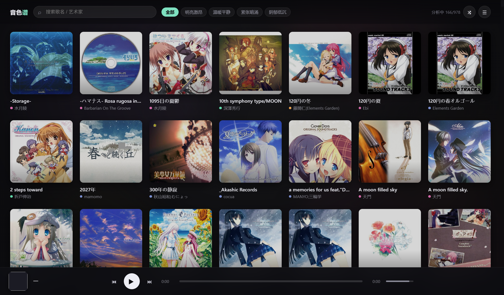
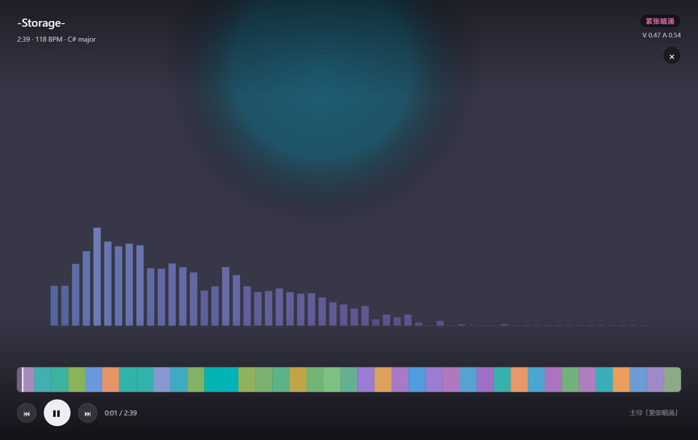
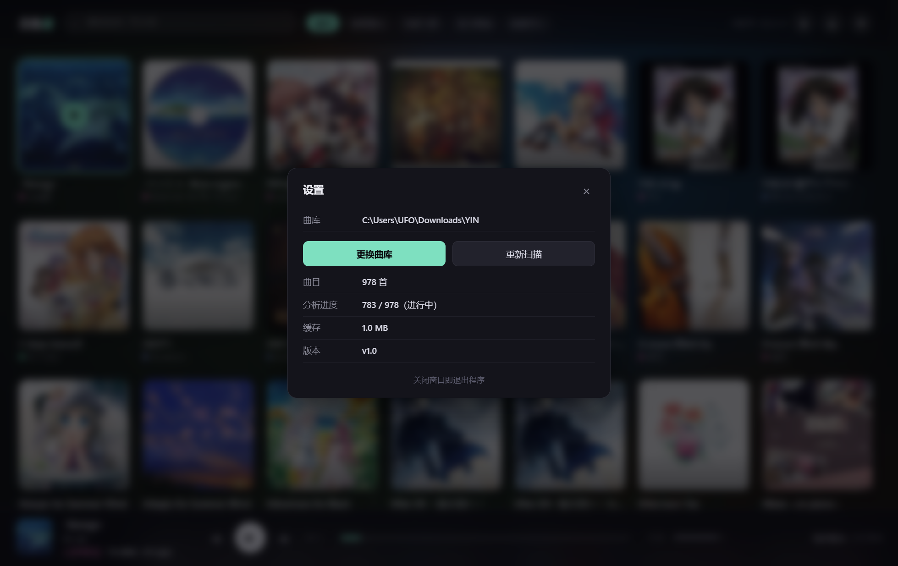

# ChromaScore · 音色谱

**把音乐的情绪变成颜色。**

一个本地音乐播放器：扫描你的曲库，从音频文件里读出真实专辑封面，逐首分析情绪，
然后用颜色把整首歌的情绪走向画出来——封面色带、全屏色场、可筛选的四象限。

不是频谱可视化，是**情绪**可视化。



---

## 它做什么

```
音频文件 ──▶ 情绪分析 (valence / arousal) ──▶ OKLCH 色彩 ──▶ 界面
```

每 4 秒一个采样点，算出两个量：

| 维度 | 含义 | 怎么算 |
|---|---|---|
| **valence** | 愉悦度（明/暗） | 调式（Krumhansl major/minor profile 相关差）+ 谱质心明亮度 + 响度 |
| **arousal** | 唤醒度（强/弱） | 响度 RMS + 速度 BPM + 谱通量（变化剧烈程度） |

再映射到感知均匀的 OKLCH 色彩空间：

```
色相 h  ← atan2(arousal-0.5, valence-0.5)   # 四象限锚点插值
彩度 C  ← |(V,A) - 中心|                     # 情感强度
明度 L  ← valence                            # 越愉悦越亮
```

四个象限对应四组颜色，和直觉一致：

| 象限 | 感觉 | 颜色 |
|---|---|---|
| 高V 高A | 明亮激昂 | 橙黄 |
| 高V 低A | 温暖平静 | 青绿 |
| 低V 高A | 紧张暗涌 | 品红 |
| 低V 低A | 阴郁低沉 | 深蓝 |



---

## 特性

- **真实专辑封面** — 读 MP3 的 ID3 APIC、FLAC 的 picture、MP4 的 covr；没有内嵌图就找同目录 `cover.jpg`
- **任意大小曲库** — 扫描本地文件，音频不内嵌，978 首扫描 6 秒
- **全屏可视化** — 点击封面进入：色场随情绪流动、实时频谱、色带时间轴
- **四象限筛选** — 按情绪挑歌，「把所有温暖平静的找出来」
- **后台分析 + 缓存** — 分析结果落盘，二次启动秒开
- **单窗口应用** — WebView2 宿主，无浏览器地址栏，关窗即退出
- **打包成 exe** — 自带 Python 运行时，双击即用

---

## 设置

曲库路径、更换目录、重新扫描、分析进度、缓存大小全部在设置页里，没有独立的控制台窗口。关掉主窗口就是退出程序。



---

## 快速开始

### 方式一：直接运行 exe（Windows）

从 [Releases](../../releases/latest) 下载 `ChromaScore.exe`，双击，选择你的音乐文件夹。
同一页有 `ChromaScore.exe.sha256`，可以拿来校验下载是否完整：

```powershell
Get-FileHash .\ChromaScore.exe -Algorithm SHA256
```

首次运行会在 `%APPDATA%\ChromaScore\` 建立配置和分析缓存。

### 方式二：源码运行

```bash
pip install -r requirements.txt
python chromascore.py "D:\Music"
```

或者把音乐文件夹拖到 `音色谱.bat` 上。

常用参数：

```bash
python chromascore.py "D:\Music" --port 8765   # 指定端口
python chromascore.py --no-gui                 # 只起服务，用浏览器访问
```

---

## 快捷键

| 键 | 作用 |
|---|---|
| `空格` | 播放 / 暂停 |
| `←` `→` | 上一首 / 下一首 |
| `Esc` | 退出可视化 / 关闭抽屉 |

---

## 项目结构

```
chromascore.py      主程序：扫描、分析、HTTP 服务、窗口
chromascore.spec    PyInstaller 打包配置
音色谱.bat           免打包的拖放入口
cdp_check.py        CDP 视觉测试（启动独立浏览器截图）
cdp_attach.py       连接已运行的 WebView2 截图
DESIGN.md           情绪映射与量化设计的完整推导
PLAN.md             后续规划
```

### 接口

| 路由 | 作用 |
|---|---|
| `GET /` | 曲库页面 |
| `GET /viz` | 直接进入可视化 |
| `GET /api/tracks` | 曲库 + 分析数据 + 进度 |
| `GET /api/status` | 曲库路径、进度、缓存大小 |
| `GET /cover?i=N` | 封面（缩到 360px，内存缓存） |
| `GET /audio?i=N` | 音频流，支持 Range |
| `POST /api/set-library` | 更换曲库（弹系统选择框） |
| `POST /api/rescan` | 重新扫描 |

---

## 开发和验证

改前端后**不要**用 `msedge --headless --screenshot` 验证——它不合成 canvas，
这个项目的画面全在 canvas 上，截出来永远是黑的（作者为此误判过三轮）。

用 CDP：

```bash
# 启动独立浏览器并截图
python cdp_check.py "http://127.0.0.1:8765/viz" shot.png --click "#openSet"

# 或者连到正在运行的 exe 窗口
set WEBVIEW2_ADDITIONAL_BROWSER_ARGUMENTS=--remote-debugging-port=9351
ChromaScore.exe
python cdp_attach.py 9351 shot.png
```

---

## 已知限制

- **凭声学特征推情绪，不是训练过的情感模型。** 分得清大小调、明暗、强弱，分不清「温柔」和「悲伤」——这两者在声学特征上太接近。要更准需要接 EMOPIA 之类带情感标注的数据集做微调。
- **首次分析慢。** 978 首约 15 分钟（4 线程）。期间界面可用、封面可看，但四象限筛选要等分析完才准。
- **暂无专辑 / 艺术家维度。** 曲库是平铺网格，找歌靠搜索。已在规划中。
- **色彩映射是启发式的。** 权重（0.62 / 0.26 / 0.12 等）来自在一批 Galgame 曲库上的分布校准，不是普适定律。

---

## 致谢

界面布局参考了这些优秀的开源本地播放器：

- [Feishin](https://github.com/jeffvli/feishin) — 三栏信息架构
- [YesPlayMusic](https://github.com/qier222/YesPlayMusic) — 视觉语言与播放条
- [Navidrome](https://github.com/navidrome/navidrome) — 曲库浏览与扫描体验
- [Museeks](https://github.com/martpie/museeks) — 本地播放器的克制

情绪表示的思路来自 Russell 的环形情感模型与 EMOPIA 数据集的工作。

---

## License

MIT
